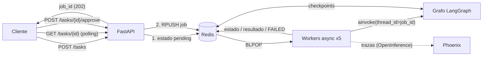
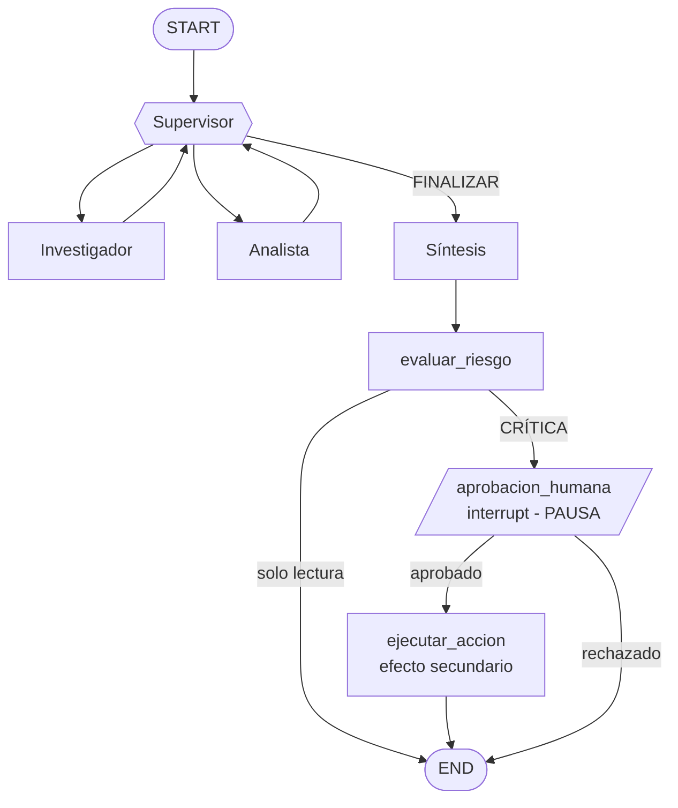

# API Multi-Agente de Producción (FastAPI + Redis + Arize Phoenix + Human-in-the-loop)

Expone el **orquestador multi-agente del Módulo 6** (Supervisor + Investigador + Analista) como una API REST asíncrona lista para producción:

- **Endpoints asíncronos:** `POST /tasks` encola el trabajo y devuelve un `job_id` en milisegundos (no ejecuta IA dentro del request).
- **Redis:** cola de jobs, estado de cada job (`pending → running → completed | rejected | FAILED`) y **checkpoints de LangGraph** (el estado de cada hilo sobrevive a reinicios).
- **Observabilidad (Arize Phoenix, o LangSmith como alternativa):** una traza por job con la jerarquía `grafo → agente → herramienta / modelo`, con tokens, costo y latencia.
- **Human-in-the-loop:** si la consulta pide una acción con efectos externos (ej. *enviar un email*), el grafo se **pausa** hasta que una persona aprueba o rechaza por la API.

## Arquitectura





## Estructura

| Ruta | Para qué sirve |
|---|---|
| `app/api.py` | API FastAPI: `/tasks`, `/tasks/{id}`, `/tasks/{id}/approve`, `/status/{id}`, `/health`. |
| `app/worker.py` | Workers asíncronos (`BLPOP`) que ejecutan el grafo; cualquier excepción deja el job en `FAILED`. |
| `app/jobs.py` | Estado de los jobs en Redis. El estado inicial se guarda **antes** de encolar. |
| `app/redis_checkpointer.py` | Checkpointer de LangGraph sobre Redis (async, solo comandos básicos de Redis). |
| `app/graph.py`, `app/state.py`, `app/agents/` | Orquestador del Módulo 6 + nodos de riesgo y aprobación. |
| `app/hitl.py` | Detección de tareas críticas, nodo `interrupt()` y ejecución de la acción. |
| `app/observability.py` | Observabilidad: Arize Phoenix (`OBSERVABILITY=phoenix`) o LangSmith. |
| `scripts/load_test.py` | Prueba de carga: 5 peticiones concurrentes. |
| `screenshots/` | Capturas del dashboard de Phoenix (trazas, costo por ejecución, p95). |
| `tests/` | Pruebas offline (fakeredis + modelos simulados). |

## Cómo correrlo (Windows PowerShell)

Requisitos: Python 3.12 o superior, Docker Desktop (para Redis) y una `GOOGLE_API_KEY` (Gemini). Phoenix corre local, sin cuenta.

```powershell
# 1) Entorno e instalación
python -m venv .venv
.\.venv\Scripts\Activate.ps1
pip install -r requirements.txt
copy .env.example .env        # completá GOOGLE_API_KEY (lo demás ya viene configurado)

# 2) Inicializar Redis (abrí Docker Desktop y esperá a que diga "running")
docker compose up -d
docker compose ps             # debe verse "healthy"

# 3) Levantar Phoenix (TERMINAL 2, con el venv activado) -> http://localhost:6006
phoenix serve

# 4) Levantar la API (TERMINAL 1)
uvicorn app.api:app --port 8000
# La primera línea debe decir: "Phoenix ACTIVO (proyecto: api-multiagente-produccion ...)"
```

Documentación interactiva en http://localhost:8000/docs. Prueba rápida (en OTRA terminal, con el venv activado; usa `Invoke-RestMethod`, que evita los problemas de comillas de `curl` en PowerShell):

```powershell
$body = @{ query = "Investigá el mercado de helados en el NOA y analizá las ventas de Helado Familiar en esa región" } | ConvertTo-Json
$r = Invoke-RestMethod -Method Post -Uri http://localhost:8000/tasks -ContentType "application/json; charset=utf-8" -Body ([System.Text.Encoding]::UTF8.GetBytes($body))
$r                                                   # devuelve el job_id al instante
Invoke-RestMethod http://localhost:8000/tasks/$($r.job_id)   # repetir hasta status = completed
```

### Human-in-the-loop (aprobación humana)

```powershell
# Consulta CRÍTICA (pide enviar un email): el job queda en "waiting_approval"
$body = @{ query = "Investigá helados en el NOA, analizá Helado Familiar y enviá el resumen por email a gerencia" } | ConvertTo-Json
$r = Invoke-RestMethod -Method Post -Uri http://localhost:8000/tasks -ContentType "application/json; charset=utf-8" -Body ([System.Text.Encoding]::UTF8.GetBytes($body))
Invoke-RestMethod http://localhost:8000/tasks/$($r.job_id)   # status: waiting_approval + accion_propuesta

# Aprobar (aprobado = $true) o rechazar ($false: la acción NO se ejecuta)
Invoke-RestMethod -Method Post -Uri http://localhost:8000/tasks/$($r.job_id)/approve -ContentType "application/json" -Body '{"aprobado": true}'
```

Como el checkpoint vive en Redis, podés **reiniciar la API** mientras el job espera y aprobarlo igual.

### Prueba de carga (5 peticiones concurrentes)

```powershell
python scripts/load_test.py --auto-approve
```

Luego abrí http://localhost:6006 → proyecto `api-multiagente-produccion` → pestaña **Traces**, y sacá las capturas indicadas en `screenshots/README.md` (jerarquía de trazas, costo por ejecución y latencia p95).

### Tests

```powershell
python -m pytest -q                                   # offline: fakeredis + modelos simulados
$env:TEST_REDIS_URL="redis://localhost:6379/15"; python -m pytest -q   # incluye la prueba de reinicio con Redis real
```

## Resultados de la prueba de carga (5 solicitudes concurrentes)

- 5 consultas enviadas a la vez (`python scripts/load_test.py --auto-approve`), una de ellas crítica (HITL), aprobada y reanudada con `job-resume`.
- Las 5 ejecuciones terminaron OK, con `WORKER_CONCURRENCY=2` y `LLM_MAX_RETRIES=10`.
- Latencia por ejecución: de 13.7 s a 1 min 55 s. P50 aprox. 1 min 19 s; P95 aprox. 1 min 48 s.
- Costo por ejecución: menos de USD 0.01 (entre 4.5k y 17k tokens).
- Nota: las latencias incluyen esperas y reintentos por el límite de cuota del plan gratuito de Gemini (15 pedidos/min). Con un plan pago serían de pocos segundos.

Capturas en `screenshots/`: `01_traza_jerarquia.png`, `02_traza_hitl.png`, `03_costo_por_ejecucion.png`, `04_latencia_p95.png`.

## Mapa con la rúbrica

| Criterio | Dónde |
|---|---|
| Orquestación asíncrona y API | `POST /tasks` encola y responde 202; workers `async`; sin llamadas bloqueantes en endpoints. |
| Persistencia con Redis | Estado de jobs (`job:{id}`), cola (`queue:tasks`) y checkpoints; ante excepción el job pasa a `FAILED`. |
| Observabilidad | Arize Phoenix (OpenInference): una traza por job (`job-start` / `job-resume`), metadata `job_id`; capturas en `screenshots/`. LangSmith queda como alternativa con `OBSERVABILITY=` vacío. |
| Human-in-the-loop | `app/hitl.py`: `interrupt()` en `aprobacion_humana`; reanuda con `Command(resume=...)` vía `/approve`. |
| Documentación y estructura | Este README, `requirements.txt`, `docker-compose.yml`, `.env.example`. |

## Notas de diseño

- **Reintentos de Gemini:** el modelo se crea con `max_retries` alto para tolerar el límite de peticiones por minuto del plan gratuito al correr 5 jobs en paralelo.
- **Sin efectos antes del `interrupt()`:** al reanudar, el nodo se re-ejecuta desde el principio; la acción real vive en el nodo siguiente.
- **Los datos (`data/`) son ficticios** y sirven solo para la demostración.
